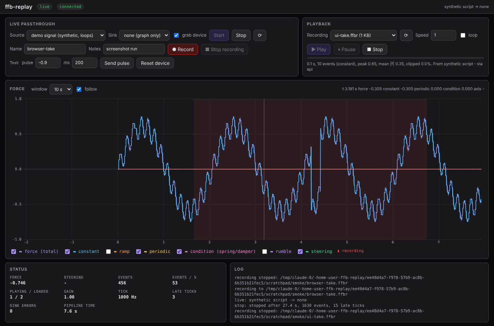

# ffb-replay

Record and play back force-feedback (FFB) signals, with a live graph.

`ffb-replay` sits between a game and a wheelbase. While recording it is a
**passthrough**: the game binds to a virtual wheel, every effect the game
sends is forwarded to the real wheel unchanged and written to a file. During
**playback** it is the source: the recording is replayed into the real
wheel on its original timeline. Either way the force is rendered to a graph
in a browser tab as it happens.

It is a small, standalone, dependency-free Rust workspace. The core crate
is platform-neutral and designed to be lifted into
[rMap](https://github.com/jason-murray/rmap) later; see
[Adopting the core elsewhere](#adopting-the-core-elsewhere).

```text
 recording:   game ──▶ virtual wheel ──▶ pipeline ──▶ real wheel
                                           │  └─▶ renderer ──▶ graph
                                           └─▶ .ffbr file
 playback:    .ffbr file ──▶ player ──▶ pipeline ──▶ real wheel
                                           └─▶ renderer ──▶ graph
```



## Status

| Piece | State |
|-------|-------|
| Core: effect model, renderer, `.ffbr` format, recorder, player, pipeline | Done, unit-tested on every platform |
| Linux backends: uinput virtual wheel (source), evdev wheel (sink) | Written against the kernel UAPI, layout-tested; **not yet exercised on real hardware** |
| Web UI with live graph, recording and playback controls | Done |
| CLI: `devices`, `record`, `play`, `info`, `export` | Done |
| Windows backends (vJoy FFB receiver as source, DirectInput as sink) | Not started; the trait seams are ready for them |

On Windows and macOS the app builds and the UI, demo source and file tools
work, but there is no device backend yet.

## Build and run

Rust stable, nothing else. There are no third-party crates.

```sh
cargo build --release
./target/release/ffb-replay            # starts the UI at http://127.0.0.1:8975/
./target/release/ffb-replay --help
```

Try it without hardware: in the UI pick source **demo signal**, sink
**none**, press **Start**, then **Record**. The demo is a synthetic signal
and is labelled as such in the recording header.

### Linux permissions

- The virtual wheel needs write access to `/dev/uinput` (the `uinput`
  module must be loaded: `sudo modprobe uinput`).
- The real wheel needs read/write access to its `/dev/input/eventN`.

A udev rule that grants both to the `input` group, for example in
`/etc/udev/rules.d/70-ffb-replay.rules`:

```text
KERNEL=="uinput", MODE="0660", GROUP="input", OPTIONS+="static_node=uinput"
SUBSYSTEM=="input", KERNEL=="event*", MODE="0660", GROUP="input"
```

then add yourself to the `input` group and log in again (or run as root
while testing).

### Recording a session

1. `ffb-replay devices` lists input devices and their FFB capabilities.
2. Start the UI, choose your wheel as the **sink** and **mirror of sink
   device** as the source. **Start** creates a virtual wheel that is a copy
   of yours (same axes, buttons, vendor and product ids, FFB features). The
   real device is grabbed so the game only sees the virtual one, and its
   steering, pedals and buttons are mirrored onto it.
3. Bind the game to the virtual wheel (the log shows its
   `/dev/input/eventN`).
4. **Record**. The file goes to `recordings/<name>.ffbr` (`--dir` changes
   the directory). Stop recording whenever; the session keeps passing
   through.

Headless equivalent:

```sh
ffb-replay record lap1 --source mirror --sink "Simagic" --notes "GT3 at Spa"
ffb-replay play lap1.ffbr --sink "Simagic" --loop
ffb-replay info recordings/lap1.ffbr
ffb-replay export recordings/lap1.ffbr --out lap1.csv --rate 500
```

`--sink` takes a device path, `eventN`, or part of the device name.

### Playback

Pick a recording, speed and loop, press **Play**. The recording's effects
are uploaded to the sink on the same timeline they were recorded on. A
recording started mid-session begins with a snapshot of the effects that
were already loaded, so playback starts from the same state. Pausing also
pauses the device, so a held force does not keep pushing the wheel.

## The graph

The graph shows the **rendered** force: the core keeps its own copy of the
device's effect table and evaluates it every tick, the way firmware does.
Constant, ramp and periodic effects (where a game's steering torque lives)
render exactly; condition effects (spring, damper, friction) use the wheel
position and velocity read from the real device and are an approximation,
since every base scales coefficients its own way.

Series: total force, and its constant / ramp / periodic / condition / rumble
parts, plus the steering position. Red bands mark where a recording was on.
Hover for a readout. `1.0` is full device force; sign follows the HID PID
direction convention (`90°` is +X).

## Recording format

`.ffbr` files are JSON Lines: a header line, then one record per line with
a microsecond timestamp. They stay readable in any text tool, `tail -f`
works on a live one, and an interrupted recording is still loadable.

```json
{"format":"ffb-replay","version":1,"created_unix":1760000000,"source":"virtual wheel 'ffb-replay: Simagic' (input23)","sink":"Simagic (/dev/input/event9)","tick_hz":1000,"notes":"GT3 at Spa"}
{"t":0,"ev":{"k":"upload","id":1,"fx":{"type":"constant","mag":0.12,"env":{"al":0,"at":0,"fl":0,"ft":0},"dur":null,"delay":0,"dir":90}}}
{"t":0,"ev":{"k":"play","id":1,"n":1}}
{"t":10034,"axis":0.031}
{"t":16667,"ev":{"k":"upload","id":1,"fx":{"type":"constant","mag":0.14,"env":{"al":0,"at":0,"fl":0,"ft":0},"dur":null,"delay":0,"dir":90}}}
```

Event kinds: `upload`, `erase`, `play`, `stop`, `gain`, `autocenter`,
`control` (`reset`, `pause`, `continue`, `stop-all`, `enable-actuators`,
`disable-actuators`). Effect types: `constant`, `ramp`, `periodic`,
`condition`, `rumble`. Magnitudes are `-1..1`, times are milliseconds,
directions are degrees. The schema is in
`crates/ffb-replay-core/src/format.rs`.

## Layout

| Crate | Role | Platform deps |
|-------|------|---------------|
| `crates/ffb-replay-core` | Effect vocabulary, renderer, `.ffbr` format, recorder, player, offline trace, tick-loop pipeline, source/sink traits | none, `unsafe` forbidden |
| `crates/ffb-replay-linux` | `VirtualWheel` (uinput, `FfbSource`) and `Wheel` (evdev, `FfbSink`), device enumeration, hand-written UAPI bindings pinned by tests | Linux |
| `app` | The `ffb-replay` binary: CLI, session manager, localhost HTTP + server-sent-events server, the single-file web UI | - |

The pipeline runs on its own thread at `--rate` Hz (default 1000). Each
tick it polls the source, forwards events to the sink and the renderer,
mirrors inputs from the sink device to the source device, samples the
renderer, writes the recording, and publishes a sample to a bounded channel
that is never allowed to block the loop.

## Adopting the core elsewhere

`ffb-replay-core` is the part meant to move into rMap. It has no
dependencies, no `unsafe`, and the hot path is allocation-free. The seams:

- `FfbSource`: where events come from. rMap's natural source on Windows is
  vJoy's FFB receiver (`FfbRegisterGenCB` packets map one-to-one onto
  `FfbEvent`: effect report → `Upload`, operation report → `Play`/`Stop`,
  gain report → `Gain`, control report → `Control`).
- `FfbSink`: where events go. `SinkMode::Rendered` is for outputs that only
  take a scalar force; rMap's DirectInput constant-force `FfbOutput` fits it
  directly (`set_force` receives the renderer's total). A full-effect
  DirectInput sink would use `SinkMode::Effects`.
- `Pipeline` / `Sample`: the UI contract. The sample stream carries the same
  fields rMap's `FfbPlot.svelte` draws (force breakdown plus steering), so
  the plot can consume it unchanged.
- `Recording` / `Player` / `offline::render_trace`: load, replay and analyse
  files.

A Windows backend crate would sit next to `ffb-replay-linux` and plug into
`app/src/backends.rs`.

## Development

```sh
cargo test --workspace
cargo clippy --workspace --all-targets -- -D warnings
cargo fmt --all
```

The Linux FFI constants and struct layouts are asserted in
`crates/ffb-replay-linux/src/ffi.rs` against values printed from the C
headers; if you change a struct, re-check it there.

## Licence

MIT.
